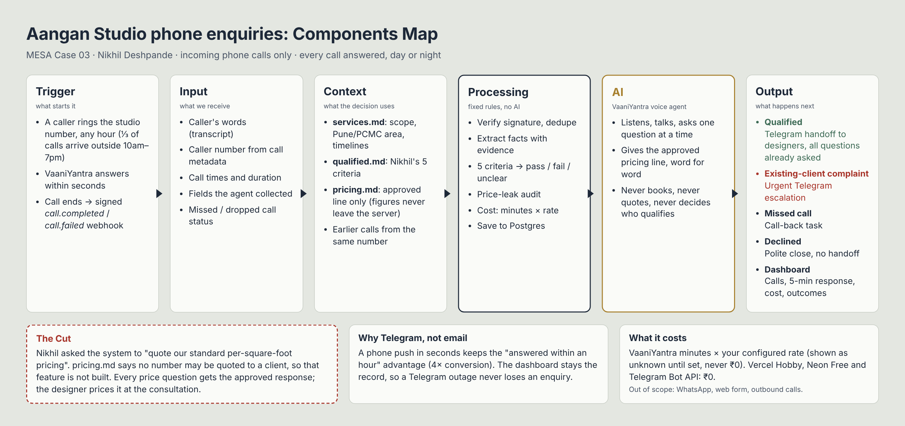

# Aangan Studio — AI phone enquiry system

MESA AI and its Application · Founder's Office · Cohort C4 · **Case 03: Nikhil — Unanswered Enquiries**

Aangan Studio (Pune, 14 designers, ~200 enquiries a month) loses enquiries: about half get no reply within 48 hours, a third arrive outside the 10 am–7 pm front-desk hours, and a reply within an hour converts at four times the next-day rate. This app answers every incoming **phone** call with a voice agent, applies Nikhil's own qualification rubric, sends designers a complete handoff on Telegram, escalates existing-client complaints, and gives Nikhil a dashboard of what it handles, what it costs, and what it generates.

**Live app:** https://aangan-enquiry-inky.vercel.app (Vercel + Neon Postgres, mock voice mode) · **Health:** https://aangan-enquiry-inky.vercel.app/api/health

> **Integration status:** Telegram handoff **live** (@aangan_designers_pa_bot). Voice: **Vaani AI live and verified end to end** (10 Oct 2026, 23:07 IST): a Vaani test call (agent `aangan-front-desk`) sent `call_postprocessing` to the signed webhook and was saved as enquiry AAN-00022 with transcript, evidence and a rules verdict. The verdict was *Incomplete*: speech-to-text heard the locality as "Koturur", and the rules only trust the caller's own words, so a follow-up was raised instead of a guess. Known gaps from that call: received time and duration were not joined from `call_started` for browser (WebRTC) test calls, and the Vaani call-history lookup returned HTTP 401, so the call's cost shows as Unknown. Also verified with the in-app simulator and 138 automated tests.

## What it does

```
 Caller ──► phone number (Twilio/Plivo/Exotel) ──► VaaniYantra voice agent  (greeting, questions,
                                                       │                      approved pricing line)
                          signed webhook  call.completed / call.failed
                                                       ▼
 ┌────────────────────────────── this app (Next.js + PostgreSQL) ─────────────────────────────┐
 │ webhook: verify HMAC → validate → store event (idempotent) → 200                            │
 │   └─ after response: GET /calls/:id (transcript) → extract facts → 5-criteria rule engine  │
 │        → enquiry + assessment + cost lines + audit → reconnection link                     │
 │        → Telegram: qualified handoff │ urgent escalation │ missed-call notice │ nothing     │
 │ dashboard: overview · enquiries · needs attention · costs · call simulator · settings      │
 └────────────────────────────────────────────────────────────────────────────────────────────┘
```

- **Rule engine, not the model, decides.** `src/lib/qualification/` turns caller speech into evidence-backed facts and applies the five criteria from `knowledge/qualified.md` with PASS/FAIL/UNCLEAR results, reasons and the quoted sentence. See [docs/business-rules.md](docs/business-rules.md).
- **Pricing is never quoted.** `pricing.md` forbids it, which overrides Nikhil's original ask (this is the Cut). Every pricing question gets the approved line verbatim. Price data never reaches the voice provider, Telegram, the API or the browser, and that is enforced by tests and a bundle scan.
- **Honest by construction.** No claimed bookings ("requested, not booked"), no claimed live transfers, no invented transcripts for missed calls, unknown costs shown as unknown, conversions "Not yet recorded" until staff record them.
- **Demo data never pollutes real numbers.** Simulator calls run through the same pipeline but are flagged `DEMO` and excluded unless you tick "Include demo calls".

## Run it locally

Requirements: Node 20+, PostgreSQL 14+.

```bash
npm ci
cp .env.example .env          # fill DATABASE_URL, SESSION_SECRET, ADMIN_EMAIL, ADMIN_PASSWORD
createdb aangan_dev           # or use any Postgres URL
npm run db:migrate
npm run db:seed               # creates the admin user
npm run db:seed -- --demo     # optional: 20 demo calls based on the September transcripts
npm run dev                   # http://localhost:3000 → sign in with ADMIN_EMAIL / ADMIN_PASSWORD
```

Then open **Call simulator**, pick a scenario (e.g. "Asks for price repeatedly") and press *Play scenario*, or start a blank call and type as a caller. Open the saved enquiry to see the five criteria, the Telegram message preview, timing and cost lines.

## Test

```bash
createdb aangan_test && createdb aangan_e2e    # isolated databases; tests refuse to run elsewhere
npm run lint
npm run typecheck
npm test                      # unit + integration (real Postgres: aangan_test)
npm run build && npm run test:e2e              # Playwright against the production build (aangan_e2e)
npm run check:bundle          # fails if pricing data or secrets reached the browser bundle
```

Override databases with `TEST_DATABASE_URL` / `E2E_DATABASE_URL`. Integration tests drop and recreate the schema of the test database.

## Key definitions

**Five-minute response** (the founder's target): start = provider call creation time (call arrival); response = provider `startedAt` + offset of the first AGENT transcript line. Never the webhook arrival time. Missed/failed calls count as measured non-responses. Calls without reliable timestamps are excluded and reported as "not measurable". Separately recorded: time to completed record, to qualification, and to designer notification. All formulas live in `src/lib/analytics/metrics.ts` and are shared by the dashboard, `/api/metrics` and the tests. Details: [docs/costs.md](docs/costs.md).

## Configure the real services (no code changes)

- **Vaani AI (course platform):** [docs/vaani.md](docs/vaani.md). Create the agent with the text from *Settings*, point an Agent Webhook at `/api/webhooks/vaani?key=…`, set `VOICE_PROVIDER=vaani` + key + secret.
- **VaaniYantra (alternative):** [docs/vaaniyantra.md](docs/vaaniyantra.md). Create the agent with the text from *Settings*, connect a number, add the webhook, set `VOICE_PROVIDER=vaaniyantra` + key + secret.
- **Telegram:** [docs/telegram.md](docs/telegram.md). Set `TELEGRAM_BOT_TOKEN` + `TELEGRAM_DESIGNER_CHAT_ID`.
- **Costs:** enter the per-minute rate from VaaniYantra → Settings → Billing in *Settings*. Record invoices as actuals.
- **Deploy:** [docs/deployment.md](docs/deployment.md) (Vercel + Supabase, cron, backups).



More: [API and webhook reference](docs/api.md) · [Security and privacy](docs/security-privacy.md) · [Troubleshooting](docs/troubleshooting.md) · [Acceptance checklist](docs/acceptance.md)

## Project layout

| Path | Responsibility |
|---|---|
| `knowledge/` | The supplied source documents, verbatim (`internal/pricing.md` is server-only; `test-material/` is regression material) |
| `src/lib/business-knowledge` | Service catalogue derived from services.md |
| `src/lib/qualification` | Fact extraction, five-criteria engine, timeline policy, budget floor (server-only) |
| `src/lib/pricing-guardrails` | Approved response, pricing-question detection, leak scanner/redaction |
| `src/lib/conversation` | Deterministic front-desk agent (simulator + spec), scenarios, VaaniYantra agent text |
| `src/lib/voice-provider` | Provider interface, VaaniYantra adapter, mock adapter |
| `src/lib/telephony-events` | Idempotent event receipt and processing pipeline |
| `src/lib/notifications` | Telegram adapter, message formats, dispatch with dedupe and retries |
| `src/lib/costs`, `src/lib/analytics` | Cost records and rates; metric formulas and queries |
| `src/lib/audit`, `auth`, `health`, `http`, `config`, `db` | Cross-cutting concerns |
| `src/app` | Dashboard pages and API routes |
| `tests/` | `unit/`, `integration/` (Postgres), `e2e/` (Playwright), `fixtures/transcripts.ts` (parses T01–T20 from the PDF text) |

## Out of scope (by the case brief)

WhatsApp, the web form, outbound or automatic callbacks, CRM, payments and calendar booking are **not** built. To add WhatsApp or the web form later: write a new adapter that produces the same `NormalisedCallEvent`-style record with `channel` set accordingly (the `channel` enum currently allows only `PHONE`). The rule engine, handoff, costs and dashboard are channel-agnostic. Keep channel as a dashboard filter so phone performance is never mixed with other channels.

## Known limitations

- VaaniYantra has not been exercised with a live account. Field semantics to confirm are listed in `docs/vaaniyantra.md`.
- On a live call, the pricing rule is enforced by the agent instructions (which contain no figures) plus post-call auditing. VaaniYantra documents no mid-call server hook, so a provider-model slip is detected and flagged, not prevented in real time.
- Fact extraction is English, rule-based and tuned to the September transcripts. Unusual phrasing ends as "incomplete → human follow-up", never as a wrong "qualified". Hindi/Marathi need rules and tests before enabling.
- Rate limiting is in-memory (per instance). No in-app user management or password reset.
- Demo first-response times are simulated and labelled as such.
